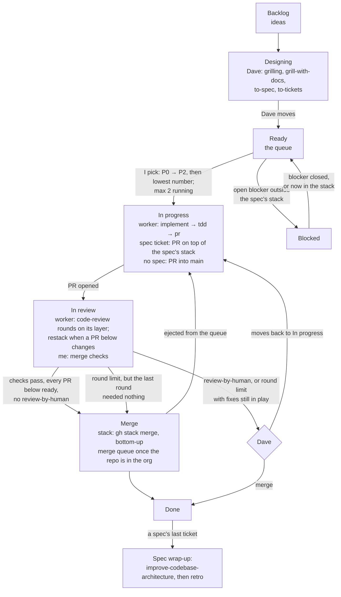

# Issue tracker: GitHub

Issues and specs for this repo are GitHub issues in `engi-ai/knowledge-pool`, and the work is tracked on the **Knowledge Pool** GitHub Project board ([engi-ai org project 1](https://github.com/orgs/engi-ai/projects/1)). Use the `gh` CLI for everything.

## Conventions

- **Create an issue**: `gh issue create --title "..." --body-file <file>`. Write multi-line bodies to a file first.
- **Read an issue**: `gh issue view <number> --json title,body,labels,comments,state`. Prefer `--json` for anything a script or agent parses.
- **List issues**: `gh issue list --state open --json number,title,body,labels,comments --jq '[.[] | {number, title, body, labels: [.labels[].name], comments: [.comments[].body]}]'`, with `--label` and `--state` filters as needed.
- **Comment on an issue**: `gh issue comment <number> --body-file <file>`
- **Apply or remove labels**: `gh issue edit <number> --add-label "..."` or `--remove-label "..."`
- **Close**: `gh issue close <number> --comment "..."`
- **Update a PR body**: `gh pr edit <n> --body-file <file>`

`gh` infers the repo from `git remote -v` when it runs inside a clone.

## The project board

The **board is the state**: a ticket's Status column says what happens to it next. Labels are information, never gates (nothing waits on a label to be picked up or unparked). The board lives in the engi-ai organization (project 1); `scripts/lib/gh.sh` defaults to it, and `KP_BOARD_OWNER` / `KP_BOARD_NUMBER` name another.

| Status | Meaning | Who acts |
|---|---|---|
| **Backlog** | an idea | Dave |
| **Designing** | being shaped into a spec and tickets (`grilling`, `grill-with-docs`, `domain-modeling`, `to-spec`, `to-tickets`, `wayfinder`) | Dave |
| **Ready** | the queue: agents may build it | Karn |
| **In progress** | a worker is building it | worker |
| **In review** | a PR is open | worker (reviews), then Karn (merge checks), or Dave |
| **Blocked** | can't move: an open blocker, or waiting on Dave | Karn or Dave |
| **Done** | merged and closed | none |

- **Add a new issue to the board**: `gh project item-add 1 --owner engi-ai --url <issue url>`. Every map, ticket and spec belongs on the board.
- **Set its status**: `scripts/board.sh <issue> <status>`, which also adds the card if it is missing. The board's workflows move a card to **Done** when its issue closes, and close an issue whose card is set to Done.
- **Choosing a status**: a ticket Dave has finished shaping goes to **Ready**; moving it there is the instruction to build it. A ticket with an open blocker, or one waiting on an answer only a human can give, goes to **Blocked** (not Backlog), and returns to **Ready** when the blocker closes or Dave answers. Exception: a ticket whose open blockers are all in the same spec's stack already can go on top of it. Move a card to **In progress** when its worker starts, to **In review** when its PR is open, and to **Done** when it merges.
- **Dave's card moves are instructions**: In review → In progress means more work, same worker; anything → Blocked, Backlog or Designing means leave it alone.
- **Read the board with one small GraphQL query** of open issues and each one's Status and Priority. Never use a full `gh project item-list`: it burns the shared 5,000-points-an-hour GitHub allowance.
- **Stacks**: a spec's tickets are one stack of PRs (see **Stack** in `CONTEXT.md`); the diagram shows where a PR sits in the loop.

### The ticket loop

## Pull requests as a triage surface

**PRs as a request surface: no.** _(Set this to `yes` if this repo treats external PRs as feature requests. `/triage` reads this flag.)_

When it is set to `yes`, PRs go through the same labels and states as issues, using the `gh pr` equivalents:

- **Read a PR**: `gh pr view <number> --json title,body,labels,comments`, and `gh pr diff <number>` for the diff.
- **List external PRs for triage**: `gh pr list --state open --json number,title,body,labels,author,authorAssociation,comments`, then keep only those whose `authorAssociation` is `CONTRIBUTOR`, `FIRST_TIME_CONTRIBUTOR` or `NONE` (drop `OWNER`, `MEMBER` and `COLLABORATOR`).
- **Comment, label or close**: `gh pr comment`, `gh pr edit --add-label` or `--remove-label`, `gh pr close`.

Issues and PRs share one number space on GitHub, so a bare `#42` may be either. Try `gh pr view 42` first, and fall back to `gh issue view 42 --json ...`.

## When a skill says "publish to the issue tracker"

Create a GitHub issue, add it to the board, and set its status to **Designing**. Dave moves it to Ready when he has finished shaping it; a ticket is never published straight to Ready.

## When a skill says "fetch the relevant ticket"

Run `gh issue view <number> --json title,body,labels,comments,state`.

## Wayfinding operations

Used by `/wayfinder`. The **map** is a single issue, and its **child** issues are the tickets. All of them go on the board.

- **Map**: one issue labelled `wayfinder:map`, holding the Notes, Decisions so far and Fog sections. Create it with `gh issue create --label wayfinder:map`.
- **Child ticket**: an issue linked to the map as a GitHub sub-issue (`gh api` on the sub-issues endpoint). Where sub-issues aren't enabled, add the child to a task list in the map body and put `Part of #<map>` at the top of the child body. Labels: `wayfinder:<type>` (`research`, `prototype`, `grilling` or `task`). Once claimed, the ticket is assigned to the driving dev.
- **Blocking**: use GitHub's **native issue dependencies**, which show in the UI. Add an edge with `gh api --method POST repos/<owner>/<repo>/issues/<child>/dependencies/blocked_by -F issue_id=<blocker-db-id>`. `<blocker-db-id>` is the blocker's numeric **database id** (`gh api repos/<owner>/<repo>/issues/<n> --jq .id`), not its `#number` or `node_id`. GitHub reports open blockers in `issue_dependencies_summary.blocked_by`, which is the live gate. Where dependencies aren't available, put a `Blocked by: #<n>, #<n>` line at the top of the child body instead. A ticket is unblocked when every blocker is closed. A blocked ticket sits in Blocked and an unblocked one in Ready.
- **Frontier query**: list the map's open children (`gh issue list --state open`, limited to the map's sub-issues or task list). Drop any with an open blocker (`issue_dependencies_summary.blocked_by > 0`, or an open issue in the `Blocked by` line) and any with an assignee. The first one left, in map order, is next.
- **Claim**: `gh issue edit <n> --add-assignee @me` is the session's first write. Then run `scripts/board.sh <n> "In progress"`.
- **Resolve**: `gh issue comment <n> --body-file <file>` with the answer, then `gh issue close <n>`, then `scripts/board.sh <n> Done`. Finally, append a pointer (one-line gist and link) to the map's Decisions so far.
